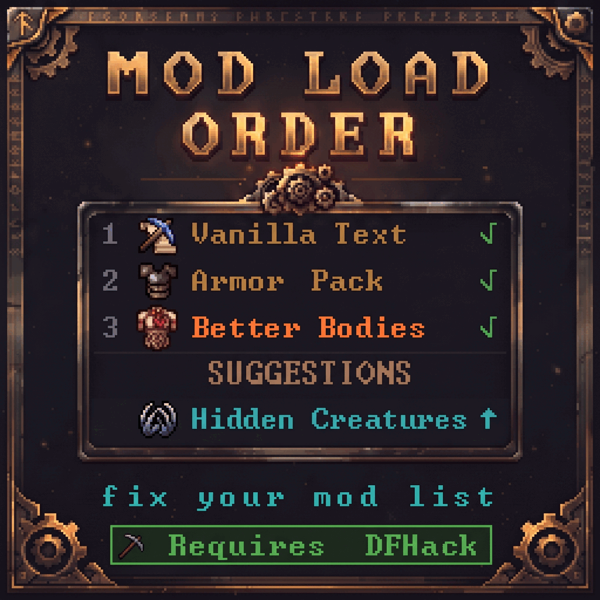
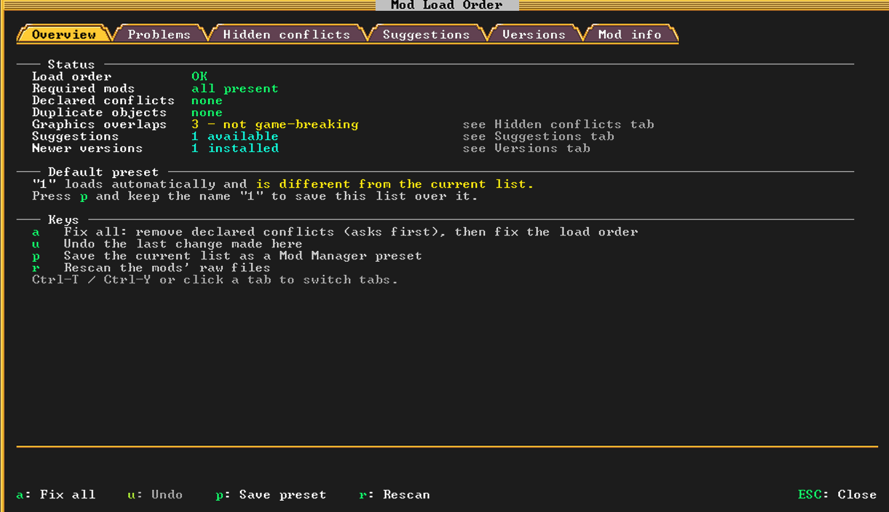
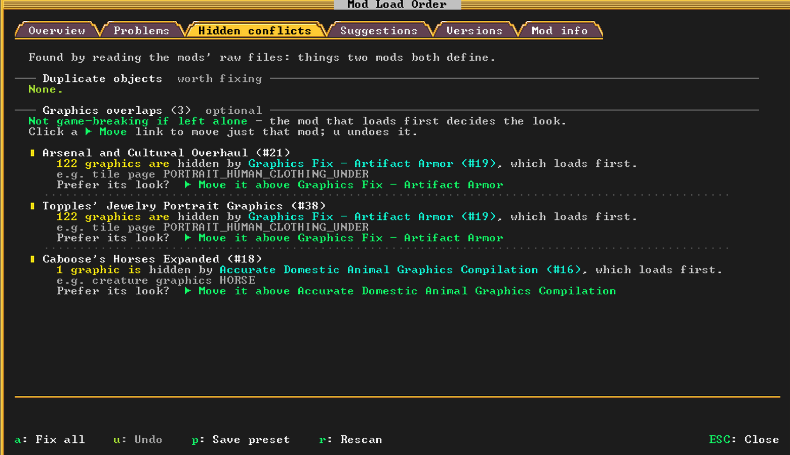
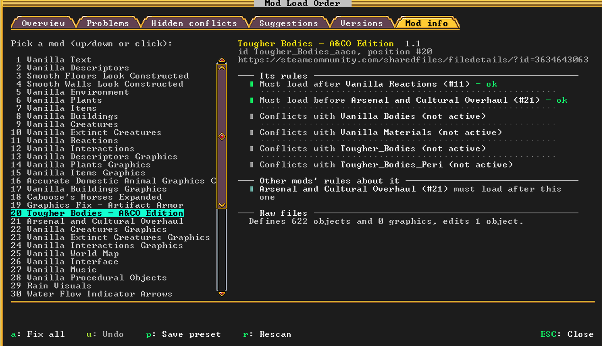

<p align="center">
  
</p>

<h1 align="center">Mod Load Order</h1>

<p align="center"><b>A DFHack tool that checks and fixes your Dwarf Fortress mod list.</b><br>
<a href="https://steamcommunity.com/sharedfiles/filedetails/?id=3844479443">Steam Workshop</a></p>


A [DFHack](https://store.steampowered.com/app/2346660/DFHack__Dwarf_Fortress_Modding_Engine/) tool for
Dwarf Fortress (Steam) that checks your active mod list on the **Create world → Mods** screen and helps fix it.



## What it does

A small panel appears on the Mods screen showing the state of your mod list
("Load order OK", "2 out of order", "1 conflict", …) with quick actions. `d` opens a tabbed window:

| Tab | What it shows |
|---|---|
| **Overview** | Status of every check at a glance, and whether your default Mod Manager preset matches the current list |
| **Problems** | Mods out of order, missing required mods, declared conflicts |
| **Hidden conflicts** | Things two mods both define, found by scanning their raw files: duplicate objects, which DF reports as errors |
| **Suggestions** | Order changes based on what the mods' files do: a mod that changes something another mod adds has to load after it |
| **Versions** | Active mods that have a newer version installed |
| **Mod info** | Pick any mod to see its rules (ok / WRONG / MISSING) and which other mods depend on it |



### Actions

| Key | Action |
|---|---|
| `a` | **Fix all** - remove declared conflicts (one checklist, one confirmation), then fix the load order |
| `f` | **Fix order** - reorder the list so every "must be before / after" rule is satisfied, moving as few mods as possible and leaving vanilla mods in place |
| `c` | **Remove conflicts** - batch checklist with suggested removals pre-ticked |
| `s` | **Apply suggestions** |
| `v` | **Use newest versions** |
| `u` | **Undo** the last change (up to 30 steps) |
| `p` | **Save** the list as a DFHack Mod Manager preset (update your default preset so it loads this way next time) |
| `l` | **Copy Workshop search links** for required mods you don't have installed |
| `r` | **Rescan** the raw files |

It also warns you if you click **Create world** while problems remain (click again within 30 seconds to create anyway).



## Install

**Steam Workshop:** subscribe. You don't need to activate it in your mod list - DFHack loads
scripts from `scripts_modinstalled/` for any installed mod.
It also hides itself from the game's mod list, since there's nothing to add there.

**Manual:** copy `scripts_modinstalled/mod-load-order.lua` into
`<Dwarf Fortress>/dfhack-config/scripts/`.

Requires DFHack.

## Console commands

```
mod-load-order          open the window (on the Mods screen)
mod-load-order check    print problems
mod-load-order fix      fix the load order
mod-load-order scan     print raw-file scan results
```

## How it works

- Load-order rules come from each mod's `info.txt` (`REQUIRES_ID_BEFORE_ME`, `REQUIRES_ID_AFTER_ME`,
  `CONFLICTS_WITH_ID`), as read by the game.
- The raw-file scan reads every active mod's `objects/` and `graphics/` files (well under a second).
  - Two mods fully defining the same object is reported as a duplicate, unless the later mod
    `CUT_`s the object first (an intentional replacement).
  - Graphics overlaps (two mods drawing the same thing - the first one loaded wins) are worked out
    but not shown for now: which art is "right" is a matter of taste, so the tool leaves graphics
    order to each mod's own rules. Set `SHOW_GRAPHICS_OVERLAPS = true` in the script to see them.
  - `SELECT_`/`CUT_` edits should load after the mod that defines the object.
- The list is changed through the same game data DFHack's own Mod Manager uses.

## Changelog

See [CHANGELOG.md](CHANGELOG.md).

## License

MIT - see [LICENSE](LICENSE).

## Workshop preview image

`preview.png` is the Workshop thumbnail (1024x1024, under Steam's 1 MB limit).
`tools/make_preview.py` can generate a simple alternative using the game's own font:

```
python3 tools/make_preview.py "<Dwarf Fortress>/data/art/curses_800x600.png" preview.png
```
